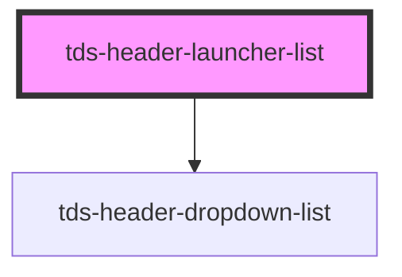

# tds-header-launcher-list

<!-- Auto Generated Below -->

## Overview

* Tegel Header Launcher List component. Composed by one Header Launcher List Title component and at least one Header Launcher List Item component.

## Slots

| Slot          | Description                          |
| ------------- | ------------------------------------ |
|               | The default slot                     |
| `"<default>"` | <b>Unnamed slot.</b> For list items. |

## Dependencies

### Depends on

- [tds-header-dropdown-list](../header-dropdown-list)

### Graph

----------------------------------------------

*Built with [StencilJS](https://stenciljs.com/)*
