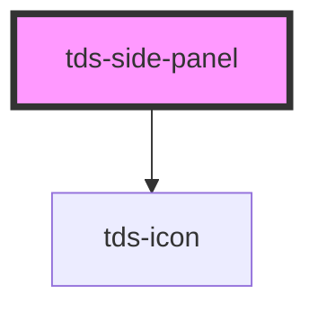

# tds-side-panel

<!-- Auto Generated Below -->

## Properties

| Property    | Attribute   | Description                                                                                                       | Type                  | Default     |
| ----------- | ----------- | ----------------------------------------------------------------------------------------------------------------- | --------------------- | ----------- |
| `bottom`    | `bottom`    | Top position in pixels to where the Side Panel will end.                                                          | `number \| undefined` | `undefined` |
| `collapsed` | `collapsed` | Controls whether the Side Panel is collapsed or not                                                               | `boolean`             | `false`     |
| `header`    | `header`    | Sets the header of the Side Panel.                                                                                | `string`              | `''`        |
| `overlay`   | `overlay`   | Controls whether the Side Panel has an overlay or not. Only applied when top and bottom positions are not in use. | `boolean`             | `false`     |
| `prevent`   | `prevent`   | Only affects when overlay is true, to prevent clicking outside from closing the Side Panel                        | `boolean`             | `false`     |
| `selector`  | `selector`  | CSS selector for the element that will show the Side Panel.                                                       | `string \| undefined` | `undefined` |
| `subheader` | `subheader` | Sets the subheader of the Side Panel.                                                                             | `string`              | `''`        |
| `top`       | `top`       | Top position in pixels from where the Side Panel will start.                                                      | `number \| undefined` | `undefined` |

## Events

| Event      | Description                             | Type                 |
| ---------- | --------------------------------------- | -------------------- |
| `tdsClose` | Emits when the Side Panel is closed.    | `CustomEvent<Event>` |
| `tdsOpen`  | Emits just before Side Panel is opened. | `CustomEvent<void>`  |

## Methods

### `closeSidePanel() => Promise<void>`

Closes the Modal.

#### Returns

Type: `Promise<void>`

### `openSidePanel() => Promise<void>`

Shows the Modal.

#### Returns

Type: `Promise<void>`

## Slots

| Slot        | Description                         |
| ----------- | ----------------------------------- |
| `"content"` | Slot for main content of Side Panel |

## Dependencies

### Depends on

- [tds-icon](../icon)

### Graph

----------------------------------------------

*Built with [StencilJS](https://stenciljs.com/)*
