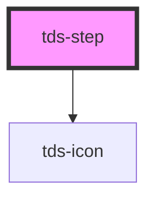

# tds-step

Custom icons in each step are supported as long as state is **current** or **upcoming**. If no icon name is defined, step node will contain the index of the step.

<!-- Auto Generated Below -->

## Properties

| Property         | Attribute          | Description                                                                        | Type                                              | Default      |
| ---------------- | ------------------ | ---------------------------------------------------------------------------------- | ------------------------------------------------- | ------------ |
| `iconName`       | `icon-name`        | Icon to show in step if state is current or upcoming.                              | `string \| undefined`                             | `undefined`  |
| `index`          | `index`            | Index of the step. Will be displayed in the step if the state is current/upcoming. | `string \| undefined`                             | `undefined`  |
| `state`          | `state`            | State of the Step                                                                  | `"current" \| "error" \| "success" \| "upcoming"` | `'upcoming'` |
| `tdsAriaCurrent` | `tds-aria-current` |                                                                                    | `string \| undefined`                             | `undefined`  |

## Slots

| Slot      | Description              |
| --------- | ------------------------ |
| `"label"` | Slot for the label text. |

## Dependencies

### Depends on

- [tds-icon](../../icon)

### Graph

----------------------------------------------

*Built with [StencilJS](https://stenciljs.com/)*
